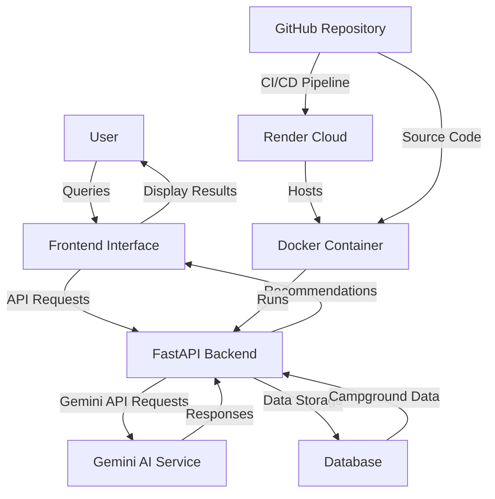

# YelpCamp AI MCP

## System Architecture



For a more detailed view of the architecture, see the [flowchart.md](flowchart.md) file.

[](https://hub.docker.com/r/shresthshukla/yelpcamp-mcp-ai)
[](https://yelpcamp-mcp-ai.onrender.com)
[](https://www.python.org/)
[](https://fastapi.tiangolo.com/)
[](https://gemini.google.com/)

## Overview

YelpCamp AI MCP is an advanced AI-powered chatbot for YelpCamp, providing intelligent recommendations and assistance for campgrounds. This application leverages FastAPI for the backend, Gemini AI for natural language processing, and is containerized with Docker for easy deployment.


## Features

- Intelligent campground recommendations
- Natural language processing for user queries
- FastAPI backend for robust API endpoints
- Docker containerization for easy deployment
- Render cloud deployment

## Screenshots


## Getting Started

### Prerequisites

- Docker installed on your machine
- Python 3.9 or higher
- A Gemini API key

### Installation

1. Clone the repository:
   ```bash
   git clone https://github.com/yourusername/yelpcamp-ai-mcp.git
   cd yelpcamp-ai-mcp
   ```

2. Create a `.env` file from `.env.example`:
   ```bash
   cp .env.example .env
   ```

3. Set `GEMINI_API_KEY` in your `.env` file.

### Running Locally

1. Install dependencies:
   ```bash
   uv sync
   ```

2. Run the application:
   ```bash
   uv run uvicorn app.main:app --reload
   ```

### Docker Setup

1. Pull the Docker image:
   ```bash
   docker pull shresthshukla/yelpcamp-mcp-ai
   ```

2. Run the container:
   ```bash
   docker run -p 8000:8000 -e GEMINI_API_KEY=your_api_key shresthshukla/yelpcamp-mcp-ai
   ```

### Render Deployment

The application is deployed on Render at [https://yelpcamp-mcp-ai.onrender.com](https://yelpcamp-mcp-ai.onrender.com).

## API Documentation

For detailed API documentation, visit the Swagger UI when running locally:

[http://localhost:8000/docs](http://localhost:8000/docs)

## Testing

Run all tests:
```bash
uv run python -m pytest
```

## Contributing

Contributions are welcome! Please read our [Contributing Guide](CONTRIBUTING.md) for details on our code of conduct and the process for submitting pull requests.

## License

This project is licensed under the MIT License - see the [LICENSE](LICENSE) file for details.

## Contact

For questions or feedback, please contact [your.email@example.com](mailto:your.email@example.com).

## Acknowledgements

- [FastAPI](https://fastapi.tiangolo.com/)
- [Gemini AI](https://gemini.google.com/)
- [Docker](https://www.docker.com/)
- [Render](https://render.com/)
