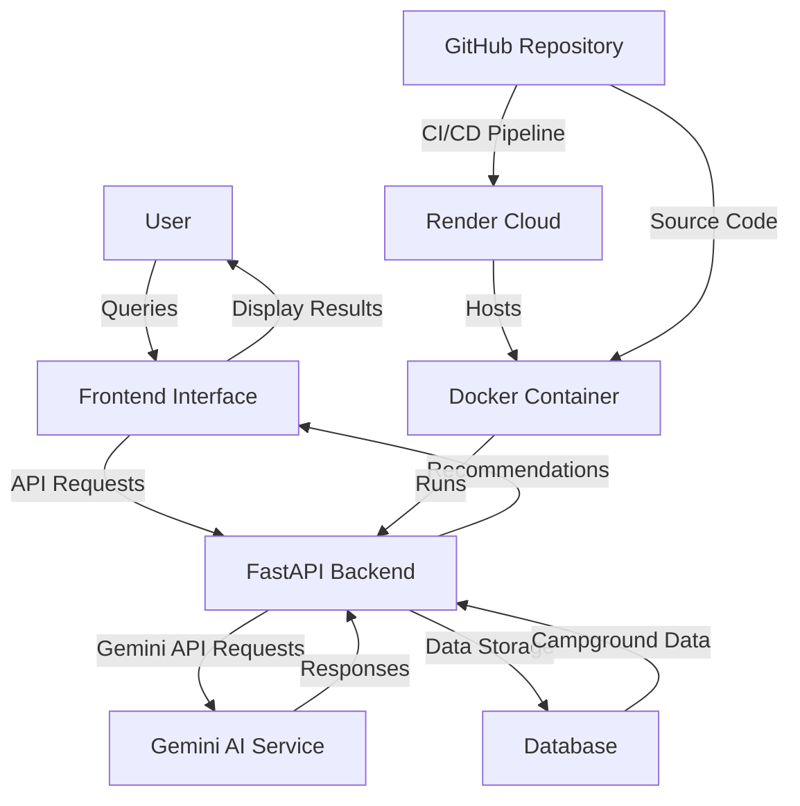

# YelpCamp AI MCP

[](https://hub.docker.com/r/shresthshukla/yelpcamp-mcp-ai)
[](https://yelpcamp-mcp-ai.onrender.com)

## System Architecture



## Architecture Components

1. **User Interface**: Web or mobile interface where users interact with the system
2. **FastAPI Backend**: Handles API requests and business logic
3. **Gemini AI Service**: Provides natural language processing and recommendations
4. **Database**: Stores campground information and user data
5. **Docker Container**: Encapsulates the application for consistent deployment
6. **Render Cloud**: Hosting platform for the deployed application
7. **GitHub Repository**: Source code management and CI/CD pipeline

## Data Flow

1. User submits a query through the frontend interface
2. Frontend sends API request to FastAPI backend
3. Backend processes request and sends to Gemini AI service
4. Gemini AI generates recommendations based on the query
5. Backend receives response and formats for display
6. Frontend displays recommendations to the user

7. Backend interacts with database for campground information

8. Source code is managed in GitHub repository
9. Docker container is built and deployed to Render cloud

## Getting Started

### Prerequisites

- Docker installed on your machine
- Python 3.9 or higher
- A Gemini API key

### Installation

1. Clone the repository:
   ```bash
   git clone https://github.com/yourusername/yelpcamp-ai-mcp.git
   cd yelpcamp-ai-mcp
   ```

2. Create a `.env` file from `.env.example`:
   ```bash
   cp .env.example .env
   ```

3. Set `GEMINI_API_KEY` in your `.env` file.

### Running Locally

1. Install dependencies:
   ```bash
   uv sync
   ```

2. Run the application:
   ```bash
   uv run uvicorn app.main:app --reload
   ```

### Docker Setup

1. Pull the Docker image:
   ```bash
   docker pull shresthshukla/yelpcamp-mcp-ai
   ```

2. Run the container:
   ```bash
   docker run -p 8000:8000 -e GEMINI_API_KEY=your_api_key shresthshukla/yelpcamp-mcp-ai
   ```

### Render Deployment

The application is deployed on Render at [https://yelpcamp-mcp-ai.onrender.com](https://yelpcamp-mcp-ai.onrender.com).

## API Documentation

For detailed API documentation, visit the Swagger UI when running locally:

[http://localhost:8000/docs](http://localhost:8000/docs)

## Testing

Run all tests:
```bash
uv run python -m pytest
```