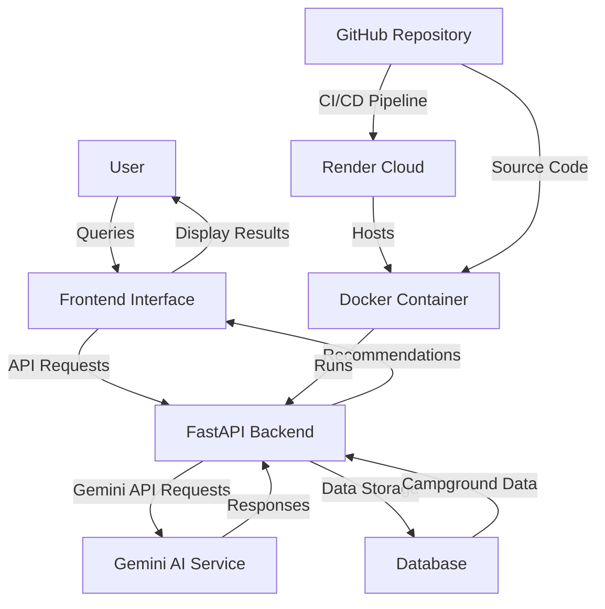

# YelpCamp AI MCP System Architecture

## Architecture Components

1. **User Interface**: Web or mobile interface where users interact with the system
2. **FastAPI Backend**: Handles API requests and business logic
3. **Gemini AI Service**: Provides natural language processing and recommendations
4. **Database**: Stores campground information and user data
5. **Docker Container**: Encapsulates the application for consistent deployment
6. **Render Cloud**: Hosting platform for the deployed application
7. **GitHub Repository**: Source code management and CI/CD pipeline

## Data Flow

1. User submits a query through the frontend interface
2. Frontend sends API request to FastAPI backend
3. Backend processes request and sends to Gemini AI service
4. Gemini AI generates recommendations based on the query
5. Backend receives response and formats for display
6. Frontend displays recommendations to the user

7. Backend interacts with database for campground information

8. Source code is managed in GitHub repository
9. Docker container is built and deployed to Render cloud

This flowchart provides a visual representation of how the YelpCamp AI MCP system components interact and connect with each other.